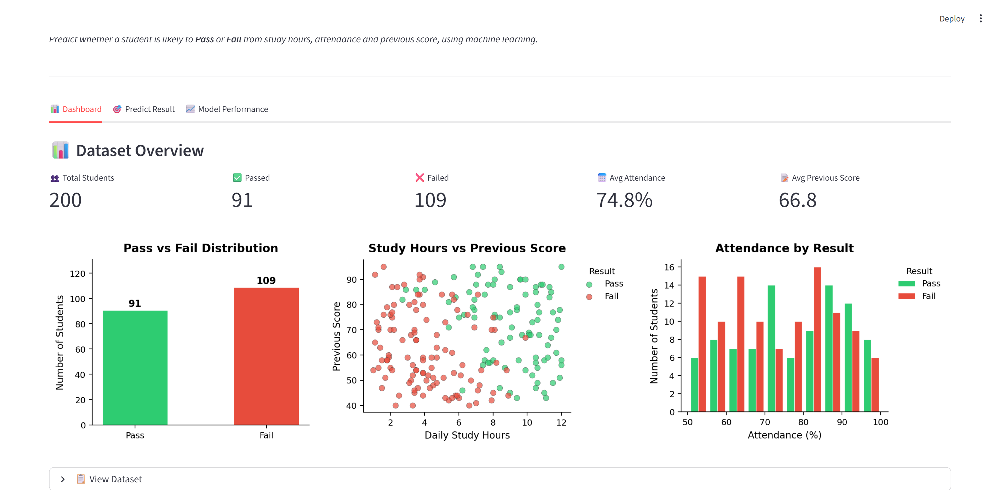
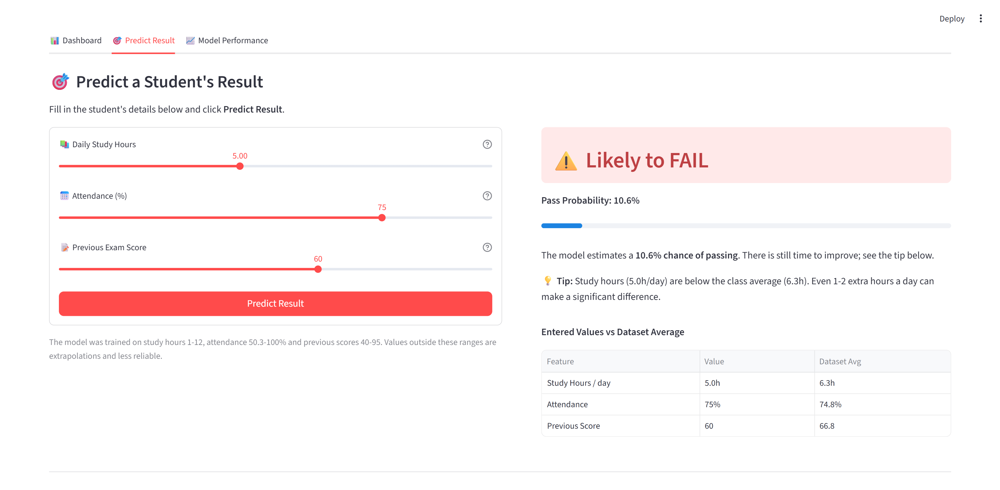
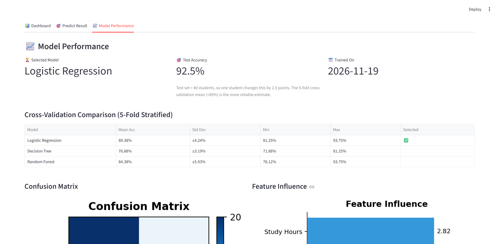

# 🎓 Student Result Predictor

A machine-learning web app that predicts whether a student is likely to **Pass** or **Fail** from their daily study hours, attendance and previous exam score.

**Live Demo:** [student-result-predictor-tirth.streamlit.app](https://student-result-predictor-tirth.streamlit.app)

| Dashboard | Predict | Model Performance |
|---|---|---|
|  |  |  |

---

## What it does

- **Dashboard**: summary cards (students, passes, fails, average attendance and previous score) plus three charts: Pass vs Fail counts, Study Hours vs Previous Score, and Attendance by Result. The full dataset can be viewed and downloaded as CSV.
- **Predict Result**: enter study hours, attendance and previous score with sliders and get a Pass/Fail prediction, the probability of passing, a short explanation, an improvement tip for likely fails, and a comparison with the dataset averages. A note shows the value ranges the model was trained on.
- **Model Performance**: the selected model, test accuracy, a 5-fold cross-validation comparison of three models, the confusion matrix, feature influence and the classification report, with a plain-English explanation of why the model was chosen.

## Tech stack

| Area | Tools |
|---|---|
| Language | Python 3.11+ |
| Data handling | Pandas, NumPy |
| Machine learning | Scikit-learn (Logistic Regression, Decision Tree, Random Forest) |
| Charts | Matplotlib |
| Web app | Streamlit |
| Model persistence | Joblib |
| Testing | Pytest (including a headless Streamlit `AppTest`) |

## Dataset

- **Source:** Kaggle, *Student Exam Scores* (by grandmaster07): 200 students with `student_id`, `hours_studied`, `sleep_hours`, `attendance_percent`, `previous_scores` and `exam_score`.
- **Label:** `Result = "Pass"` if `exam_score >= 35`, otherwise `"Fail"`.
- **Columns used** (`data.csv`): `Student_ID`, `Study_Hours`, `Attendance`, `Previous_Score`, `Result`.
- **Dropped:** `exam_score` (the label is derived from it, so using it as a feature would be label leakage) and `sleep_hours`.
- **Class balance:** 91 Pass (45.5%) / 109 Fail (54.5%). No missing values.
- **Ranges:** study hours 1-12, attendance 50.3-100%, previous score 40-95.
- **Synthetic fallback:** if `data/raw/student_exam_scores.csv` is not present, `data_prep.py` generates a reproducible synthetic dataset (NumPy, seed 42) with the same columns, so the pipeline always runs. The cleaned `data.csv` is committed, so the app does not need the raw file.

## Project structure

```
student-result-predictor/
├── app.py                # Streamlit app (3 tabs)
├── model.py              # Training, evaluation, model loading and predict()
├── data_prep.py          # Raw Kaggle CSV -> data.csv (or synthetic fallback)
├── data.csv              # Cleaned dataset used for training
├── models/
│   ├── model.joblib      # Trained pipeline (StandardScaler + LogisticRegression)
│   └── metrics.json      # Accuracy, CV results, confusion matrix, sklearn version, ...
├── tests/
│   └── test_model.py     # Pytest suite (data, model, retraining, app smoke test)
├── assets/               # Screenshots for this README
├── requirements.txt      # Runtime dependencies
└── requirements-dev.txt  # Runtime + pytest
```

## Run locally

```bash
python -m venv venv
# Windows: venv\Scripts\activate     macOS/Linux: source venv/bin/activate
pip install -r requirements-dev.txt

python data_prep.py      # optional: rebuild data.csv from data/raw/
python model.py          # optional: retrain and rewrite models/
streamlit run app.py     # open http://localhost:8501
pytest -v                # run the tests
```

`data.csv` and the trained model are committed, so `streamlit run app.py` works straight after installing. If the model file is missing, cannot be loaded, or was saved with a different scikit-learn version, the app retrains it automatically on start-up (it takes a few seconds and gives the same result because `random_state=42` is used everywhere).

## How the ML model works

1. **Features:** `Study_Hours`, `Attendance`, `Previous_Score`. **Target:** `Result` (Pass = 1, Fail = 0).
2. **Split:** stratified 80/20 train/test split (`random_state=42`): 160 training and 40 test students, with the same Pass/Fail ratio in both.
3. **Candidates:** Logistic Regression (in a `StandardScaler` pipeline), Decision Tree and Random Forest (100 trees).
4. **Model comparison:** 5-fold stratified cross-validation on the training set only:

   | Model | Mean CV accuracy | Std dev |
   |---|---|---|
   | **Logistic Regression** | **89.4%** | ±4.2% |
   | Random Forest | 84.4% | ±5.9% |
   | Decision Tree | 76.9% | ±3.2% |

5. **Why Logistic Regression:** it had the highest mean cross-validation accuracy. It is also simple, interpretable and gives well-calibrated probabilities, which suits a small dataset with three numeric features. (The selection rule would also prefer it if it were within 2 percentage points of a more complex model, but that rule was not needed here.)
6. **How a prediction is made:** the three inputs are standardised with the mean and standard deviation learned from the training data (`StandardScaler`). The model computes a weighted sum, `z = b + w1·hours + w2·attendance + w3·previous`, and passes it through the logistic function `p = 1 / (1 + e^-z)` to get the probability of passing. If `p >= 0.5` the prediction is **Pass**, otherwise **Fail**. The learned standardised weights are study hours 2.82, previous score 1.25 and attendance 0.92, so study hours have the strongest effect and all three push towards Pass as they increase.

## Results

- **Cross-validation accuracy:** ≈89.4% (5-fold, training set), the more reliable estimate.
- **Test accuracy:** 92.5% on 40 held-out students (one student = 2.5 percentage points).
- **Confusion matrix (test set):**

  |  | Predicted Fail | Predicted Pass |
  |---|---|---|
  | **Actual Fail** | 20 | 2 |
  | **Actual Pass** | 1 | 17 |

  Fail: precision 0.95, recall 0.91. Pass: precision 0.89, recall 0.94. Three of the 40 test students were misclassified.

## Limitations

- **Small dataset:** 200 students, so the 40-student test score is noisy. Treat accuracy as roughly 89-92%.
- **Only three features:** sleep, motivation, teaching quality, health and many other factors are not modelled.
- **Derived labels:** Pass/Fail comes from a fixed cutoff (exam score >= 35), so students just either side of 35 are hard to separate.
- **Estimates, not certainties:** predictions are probabilities learned from this dataset and should not be used to make decisions about real students. Inputs outside the training ranges are extrapolations.

## Future improvements

- Train on a larger and more varied dataset with additional features (e.g. sleep, homework completion).
- Predict the exam score itself (regression) as well as Pass/Fail.
- Add probability calibration plots and per-prediction explanations (e.g. SHAP).
- Let users upload a CSV for batch predictions.
- Add CI (GitHub Actions) to run the tests on every push.

## Deployment (Streamlit Community Cloud)

1. Push this repository to GitHub.
2. Go to [share.streamlit.io](https://share.streamlit.io), sign in with GitHub and click **Create app**.
3. Select the repository, branch `main` and main file `app.py`. Under **Advanced settings**, choose Python 3.11 or 3.12.
4. Click **Deploy**. Dependencies are installed from `requirements.txt`. If the committed model was saved with a different scikit-learn version, the app retrains it on the first start.
